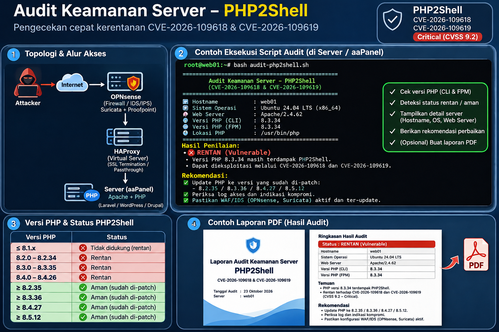

# PHP2Shell Security Audit (Linux / aaPanel)

Audit **read-only** versi binary PHP yang ditemukan di server Linux, termasuk instalasi umum aaPanel. Script tidak mengirim payload, tidak scanning eksternal, tidak mengubah konfigurasi, dan tidak mengirim data ke internet.



> **Perhatian:** gambar di atas adalah mockup konseptual, **bukan screenshot hasil nyata**. Audit ini bukan bukti bahwa aplikasi pasti bisa atau tidak bisa dieksploitasi.

## PHP2Shell

Dua CVE: **CVE-2026-109618** dan **CVE-2026-109619**, diumumkan pada 21 Oktober 2026. Batas versi PHP resmi yang telah diperbaiki adalah **8.2.35, 8.3.36, 8.4.27, dan 8.5.12**. PHP yang didistribusikan vendor OS bisa memperoleh **backport patch**, sehingga nomor versi saja tidak bisa memastikan status final.

Sumber: [NHS England](https://digital.nhs.uk/cyber-alerts/2026/cc-4875), [Plesk advisory](https://support.plesk.com/hc/en-us/articles/44397729587351-Vulnerability-CVE-2026-109618-and-CVE-2026-109619-PHP2Shell-Remote-code-execution-in-PHP-shipped-with-Plesk).

## Instalasi dan penggunaan

Butuh Linux dengan **Python 3**. Salin `audit_php2shell.py` ke server, lalu:

```bash
python3 audit_php2shell.py
```

Opsional membuat PDF (butuh `reportlab`):

```bash
python3 -m pip install reportlab
python3 audit_php2shell.py --pdf
# atau dengan nama laporan khusus:
python3 audit_php2shell.py --pdf laporan-web01.pdf
```

> Di server produksi, gunakan virtualenv Python bila kebijakan OS melarang pip global. Skrip bisa dijalankan tanpa root untuk sebagian besar lokasi binary; root mungkin diperlukan untuk menemukan beberapa runtime tertentu, tetapi jangan menjalankan instalasi pip sebagai root tanpa alasan.

## Fungsi

1. Menampilkan hostname, OS, waktu audit, dan beberapa service aktif yang terdeteksi.
2. Menemukan binary PHP di lokasi lazim: `/www/server/php/*/bin/php`, `/usr/bin/php*`, `/usr/local`, dan beberapa path distro lainnya.
3. Mengambil versi PHP tiap binary dan membandingkan dengan batas patch upstream.
4. Menampilkan kategori `PATCHED_VERSION`, `AT_RISK`, `EOL_REVIEW`, atau `UNKNOWN`.
5. Mencetak hasil terminal; opsional laporan PDF lokal.
6. Mengembalikan exit code `1` bila terdapat versi berisiko/perlu verifikasi EOL; `0` selain itu; `2` bila pembuatan PDF gagal.

## Contoh output (simulasi)

```text
======================================================================
PHP2Shell SECURITY AUDIT | CVE-2026-109618 / CVE-2026-109619
Hanya pemeriksaan versi lokal, tanpa eksploitasi
======================================================================
Hostname        : web01
OS              : Ubuntu-24.04
Service aktif   : apache2
----------------------------------------------------------------------
[AT_RISK] PHP 8.3.34 @ /www/server/php/83/bin/php
  Di bawah versi patch upstream 8.3.36; backport vendor mungkin ada.
----------------------------------------------------------------------
PATCH UPSTREAM: 8.2.35 | 8.3.36 | 8.4.27 | 8.5.12
PENTING: PHP CLI != PHP yang melayani web; verifikasi FPM/mod_php/container.
```

## Batasan penting

- Script memeriksa **binary PHP lokal**, **tidak memastikan PHP mana yang melayani tiap website**. Periksa konfigurasi aaPanel per site, PHP-FPM pool, mod_php, container, atau runtime embedded.
- `PATCHED_VERSION` hanya menyatakan batas versi upstream terpenuhi; bukan jaminan server aman dari serangan lainnya.
- `AT_RISK` adalah prioritas untuk diperiksa/di-update, bukan bukti bahwa eksploitasi berhasil. Paket vendor dengan patch backport bisa tetap menggunakan nomor versi lama.
- `EOL_REVIEW` harus ditangani dengan verifikasi backport atau migrasi ke versi yang didukung.
- HAProxy, OPNsense, Suricata/Proofpoint dan sertifikat SSL bukan pengganti update PHP.
- Bila ada dugaan kompromi, audit log dan indikator web shell secara terpisah.

## Saran tindakan

Identifikasi runtime web yang **benar-benar aktif**, periksa changelog/advisory paket OS atau vendor PHP, upgrade ke versi patched yang sesuai, backup dan uji aplikasi, lalu restart service PHP-FPM/Apache sesuai prosedur change management.

Lisensi: MIT.
